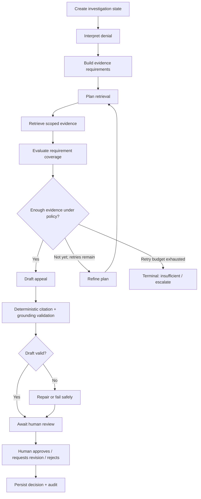

# Agent Workflow — LangGraph Investigation

## 1. What makes it agentic?
A fixed RAG pipeline searches once and writes an answer. This project has an investigation goal, saved state, several possible tool actions, an evidence-sufficiency check, conditional retry and explicit stop conditions. The graph—not free-form text from the model—controls the allowed path.

## 2. Graph

## 3. State object
Use a typed, serializable state containing:
- run ID, internal graph thread/checkpoint ID and dataset build/index version;
- claim, denial and permitted patient/organization scope;
- normalized denial interpretation;
- evidence requirements with stable IDs and definitions;
- current retrieval plan, attempt count and search budget;
- attempted query/tool history;
- retrieved evidence with exact source references;
- assessment per requirement (supported/partial/missing/conflict/unknown);
- missing evidence list and conflict list;
- draft candidates and deterministic grounding report;
- terminal outcome/error code and timing.

The browser receives a public `run_id`; it must not need the internal LangGraph thread ID. PII/clinical free text should be excluded from generic logs where not required.

## 4. Nodes

### Interpret denial
Parse the synthetic denial/remittance and select a category. Use structured schema output and deterministic validation. An unknown reason must become `unknown/needs human review`, not be guessed into a familiar category.

### Build evidence requirements
Use versioned requirement templates keyed by denial category and synthetic policy version. The LLM may recommend or explain requirements, but the validated template/rule layer defines the required set and records why each requirement exists.

### Plan retrieval
Create typed queries and allowed source targets per requirement. Include patient ID, temporal bounds, resource types and relevant policy/authorization context. No arbitrary unscoped query.

### Retrieve evidence
Run structured lookup, lexical search and dense search through backend tools. Enforce patient/organization scope in code before returning results. Attach source ID, document ID, date, retrieval method, rank/score and index version.

### Evaluate coverage
Assess each requirement using retrieved source content, source dates, contradiction signals and configured rules. “Found a semantically similar note” does not automatically mean “supported.” Distinguish direct support, partial support, conflicting evidence, irrelevant evidence and absence.

### Re-plan/retry
Retry count and budget are set in validated server configuration, not by the model. Each retry must change the plan/query or explain why a new source is needed. Terminate on sufficient evidence, exhausted budget, repeated no-op plan, timeout, tool failure or unsafe/invalid state.

### Draft appeal
Generate a structured draft with sections, factual assertions, source citations and unresolved gaps. Only cite evidence IDs returned for the current run and authorized patient. Missing facts must be omitted or explicitly described as not found; never invent diagnoses, dates, approvals or provider statements.

### Grounding validation
Deterministic validation checks that every citation exists, belongs to the current patient and dataset scope, and is associated with the current run. Check that cited resources have not been deleted/invalidated since retrieval. Optional entailment/claim checks can flag unsupported sentences but do not prove absolute truth.

### Human decision
Human review is an explicit API operation. Approval applies to a specific draft version and grounding report. Request revision creates a new work item/run or revision state. Rejection requires a reason code/comment where configured. The agent cannot self-approve.

## 5. Terminal outcomes
- `READY_FOR_REVIEW`
- `INSUFFICIENT_EVIDENCE`
- `CONFLICTING_EVIDENCE`
- `REQUIRES_MANUAL_INVESTIGATION`
- `FAILED_RETRIEVAL`
- `MODEL_UNAVAILABLE`
- `TIMED_OUT`
- `CANCELLED`
- `INVALID_OUTPUT`

A technical error must not masquerade as “no evidence found.”

## 6. Checkpointing and idempotency
- Use supported LangGraph checkpoint storage with PostgreSQL or another explicitly selected durable checkpoint backend; document version and schema.
- Keep domain records in PostgreSQL separately from graph checkpoints.
- Save a checkpoint at safe graph boundaries.
- Starting the same idempotency key must not create duplicate investigations unintentionally.
- Resuming after restart must preserve retry budget and must not repeat irreversible human/export actions.

## 7. Tool allow-list
Only provide explicit tools such as:
- get claim/denial context;
- get permitted FHIR resource by ID;
- query allowed patient-scoped resource types;
- search evidence for current patient/tenant;
- fetch payer policy version;
- persist assessment/draft through trusted service methods.

No arbitrary SQL generation, unrestricted file system, open internet browsing of clinical data, shell access or direct payer submission tool.

## 8. Failure handling
Test malformed model output, model timeout, FHIR timeout, missing index, corrupt FAISS file, no results, duplicate search plan, insufficient evidence, contradictory dates, unknown citation, wrong-patient citation, persistence failure, worker restart and human review concurrency. All outcomes must be observable and auditable.
