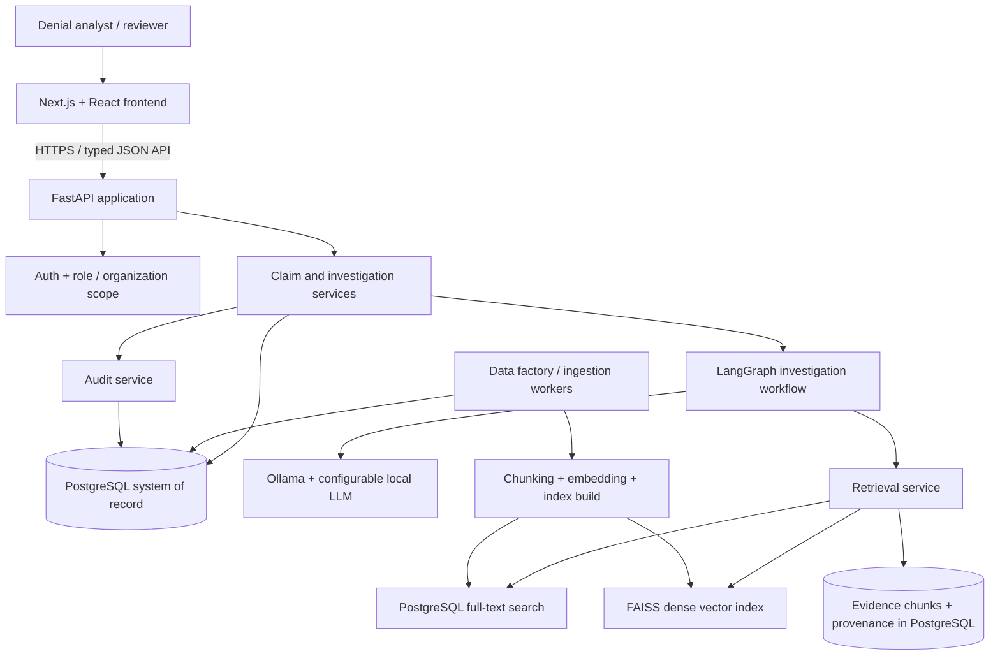
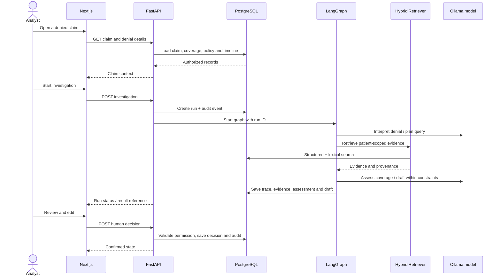

# System Architecture

## 1. Main idea
Think of the platform as five parts: (1) user interface, (2) application API, (3) durable healthcare/claims database, (4) retrieval system, and (5) bounded AI workflow. The UI asks the API for information; it never queries the database, vector index or local model directly.

## 2. High-level diagram

## 3. Recommended stack

| Layer | Decision | Notes |
|---|---|---|
| Frontend | Next.js App Router, React, TypeScript | Page routing, components and typed view models |
| Styling | Tailwind + CSS variables/design tokens | Custom visual language, not template defaults |
| Motion | Motion for React (`motion`) | Layout transitions, drawers, row states, staged workflow feedback |
| Primitives | Radix/shadcn selectively | Accessible dialog, select, tabs, tooltip, command palette; custom skin |
| Backend API | FastAPI + Pydantic v2 | Authenticated REST, OpenAPI, validation |
| Domain/data layer | Python service modules + SQLAlchemy 2 | Keep business rules out of route handlers |
| Schema migrations | Alembic | Version-controlled PostgreSQL schema |
| System of record | PostgreSQL | Relational records, JSONB FHIR payloads, full-text index metadata |
| Search | PostgreSQL full-text + FAISS | Lexical and dense retrieval, combined by RRF |
| Embeddings | BGE-small-en-v1.5 initially | Local embedding candidate; benchmark it against alternatives |
| Orchestration | LangGraph + LangChain Core | Typed, stateful graph with conditional routes and bounded retries |
| Local model | Ollama + Qwen3-8B initially | Model is configurable; integration tests still required |
| Jobs | Worker queue (Redis + Celery/RQ or an approved equivalent) after Phase 0 | Use for bulk generation/indexing and long runs; decide based on measured need |
| Quality | pytest, Playwright, Ruff, TypeScript/ESLint | Unit, integration and browser acceptance tests |

Versions are pinned during Phase 0 based on compatibility with the recovered codebase and installed Python/Node. Avoid inventing version pins in advance.

## 4. Service boundaries

### Frontend
- Renders the queue, investigation trace, evidence details, appeal editor, review actions, data-lab status and audit timeline.
- Calls only FastAPI.
- Owns view state (filters, selected tab, drawer visibility), not claim truth or authorization decisions.
- Displays backend job state rather than simulating progress.

### FastAPI application
- Authenticates the user and validates organization/patient scope.
- Calls domain services and repositories.
- Creates investigation runs, returns job/run IDs, serves trace/evidence/draft, accepts review decisions, and controls export.
- Applies state transitions and idempotency rules.

### PostgreSQL
- Canonical store for generated patients, FHIR resources, claims, insurance coverage, payer policies, denial events, investigations, drafts, decisions and audit records.
- Stores chunks and enough metadata to rebuild retrieval indexes.
- Does not store an embedding-index binary as the only evidence copy.

### Retrieval service
- Applies access and patient scope first.
- Runs structured FHIR/domain lookups and text retrieval.
- Combines lexical and dense ranked lists with configured RRF weights.
- Returns source-grounded EvidenceItems with exact resource/chunk IDs and retrieval metadata.

### LangGraph agent
- Interprets a denial, builds a requirement set, plans retrieval, observes evidence, evaluates coverage, optionally retries and drafts only after the configured evidence gate.
- Calls constrained backend tools, not arbitrary filesystem/network access.
- Cannot bypass authorization or submit a payer-facing appeal.

### Synthetic data factory
- Builds a consistent fictional world from a master seed: organizations, people, coverage, clinical timeline, claims, denial events, policies, letters, appeal activities and expected labels.
- Produces data profiles, validation reports and source records.

## 5. Claim-to-appeal sequence

## 6. Durable vs derived data
**Durable/canonical:** normalized records, raw generated FHIR resources, source note text, claims, denials, policy versions, gold labels, drafts, review actions, audit events, generator metadata.

**Derived/rebuildable:** document chunks (though the chunk text/IDs are also stored), embeddings, FAISS index, lexical search materialization, cached summaries and metrics.

Every index build records corpus version, generator seed/profile, embedding model/version, chunker version, index type, build date and row counts. An index mismatch should cause a visible degraded state and a rebuild instruction, not silent zero-result success.

## 7. Deployment path
Development starts locally with versioned configuration. Add containerized Postgres/worker setup only if Phase 0 determines that it best matches the actual Windows environment; do not make Docker a surprise prerequisite. Production-grade deployment later needs secrets management, backups, migrations, authenticated TLS, monitoring, worker control and documented recovery.

## 8. Why not use one database for everything?
PostgreSQL is authoritative for relationships and workflow state. FAISS is a specialized search index for vector similarity. Keeping them separate is reasonable only because the FAISS index can be deterministically rebuilt and is paired with metadata in PostgreSQL. If maintenance or scale makes this awkward, benchmark pgvector or a dedicated vector service before switching; do not migrate based on fashion.
