# Entity-Relationship Diagram (ERD) & Relational Model Specification

**Project Title:** Agentic Evidence-Retrieval & Appeal Generation for Insurance Claim Denial Management  
**Specification Status:** Phase 1 Design & Specification Contract (Authoritative)  
**System of Record:** PostgreSQL 18

---

## 1. Domain Architecture & Relational Topology

The database models a comprehensive healthcare revenue cycle ecosystem across four tightly coupled domains:
1. **Identity, Multi-Tenancy & Access:** Organizations, facilities, practitioners, application users, RBAC roles, and synthetic patient identities.
2. **Clinical Records & FHIR:** Encounters, clinical conditions, procedures, observations, medication requests, diagnostic reports, plain-text clinical documents, and canonical FHIR R4 JSONB payloads.
3. **Insurance, Claims & Denials:** Payers, health plans, member coverage, fee schedules/service codes, prior authorizations, medical claims, claim lines, electronic remittance advice (835), line-level adjustments, denial events, payer policy versions, appeals, versioned drafts, human decisions, and controlled exports.
4. **Investigation, Retrieval, Evaluation & Audit:** Agent investigation runs, retrieval attempts, extracted evidence chunks, requirement assessments, ground-truth benchmark labels, immutable audit events, dataset build manifests, and vector index builds.

---

## 2. Mermaid Entity-Relationship Diagram

```mermaid
erDiagram
    ORGANIZATIONS ||--o{ FACILITIES : operates
    ORGANIZATIONS ||--o{ PRACTITIONERS : employs
    ORGANIZATIONS ||--o{ ORGANIZATION_MEMBERSHIPS : includes
    ORGANIZATIONS ||--o{ CLAIMS : bills
    ORGANIZATIONS ||--o{ PATIENTS : manages
    
    USERS ||--o{ ORGANIZATION_MEMBERSHIPS : holds
    USERS ||--o{ USER_ROLES : has
    ROLES ||--o{ USER_ROLES : grants
    USERS ||--o{ CLAIMS : assigned_to
    USERS ||--o{ APPEAL_DECISIONS : decides
    USERS ||--o{ AUDIT_EVENTS : triggers

    PATIENTS ||--o{ ENCOUNTERS : experiences
    PATIENTS ||--o{ CONDITIONS : diagnosed_with
    PATIENTS ||--o{ PROCEDURES : undergoes
    PATIENTS ||--o{ OBSERVATIONS : measured_for
    PATIENTS ||--o{ MEDICATION_REQUESTS : prescribed
    PATIENTS ||--o{ DIAGNOSTIC_REPORTS : receives
    PATIENTS ||--o{ CLINICAL_DOCUMENTS : documented_in
    PATIENTS ||--o{ FHIR_RESOURCES : has_fhir
    PATIENTS ||--o{ COVERAGE : insured_under
    PATIENTS ||--o{ CLAIMS : subject_of
    PATIENTS ||--o{ EVIDENCE_CHUNKS : scoped_to

    PAYERS ||--o{ PAYER_PLANS : offers
    PAYERS ||--o{ PAYER_POLICY_VERSIONS : issues
    PAYERS ||--o{ REMITTANCES : sends
    PAYER_PLANS ||--o{ COVERAGE : provides
    
    FACILITIES ||--o{ ENCOUNTERS : hosts
    PRACTITIONERS ||--o{ ENCOUNTERS : attends
    PRACTITIONERS ||--o{ CLAIMS : renders

    ENCOUNTERS ||--o{ CONDITIONS : during
    ENCOUNTERS ||--o{ PROCEDURES : during
    ENCOUNTERS ||--o{ OBSERVATIONS : during
    ENCOUNTERS ||--o{ MEDICATION_REQUESTS : during
    ENCOUNTERS ||--o{ DIAGNOSTIC_REPORTS : during
    ENCOUNTERS ||--o{ CLINICAL_DOCUMENTS : generates

    COVERAGE ||--o{ AUTHORIZATIONS : authorizes
    COVERAGE ||--o{ CLAIMS : primary_for
    AUTHORIZATIONS ||--o{ CLAIM_LINES : references

    CLAIMS ||--o{ CLAIM_LINES : contains
    SERVICE_CODES ||--o{ CLAIM_LINES : codes
    CLAIMS ||--o{ REMITTANCE_LINES : adjudicated_in
    REMITTANCES ||--o{ REMITTANCE_LINES : aggregates
    CLAIM_LINES ||--o{ REMITTANCE_LINES : adjusts
    
    CLAIMS ||--o{ DENIAL_EVENTS : incurs
    CLAIM_LINES ||--o{ DENIAL_EVENTS : specifies
    PAYER_POLICY_VERSIONS ||--o{ DENIAL_EVENTS : cites
    
    DENIAL_EVENTS ||--o{ APPEALS : initiates
    APPEALS ||--o{ APPEAL_DRAFT_VERSIONS : tracks
    APPEAL_DRAFT_VERSIONS ||--o{ APPEAL_DECISIONS : reviewed_in
    APPEAL_DRAFT_VERSIONS ||--o{ EXPORTS : exported_from

    DENIAL_EVENTS ||--o{ INVESTIGATION_RUNS : investigates
    INVESTIGATION_RUNS ||--o{ RETRIEVAL_ATTEMPTS : executes
    INVESTIGATION_RUNS ||--o{ EVIDENCE_ASSESSMENTS : evaluates
    INVESTIGATION_RUNS ||--o{ APPEAL_DRAFT_VERSIONS : produces

    CLINICAL_DOCUMENTS ||--o{ EVIDENCE_CHUNKS : chunked_into
    FHIR_RESOURCES ||--o{ EVIDENCE_CHUNKS : derived_from
    EVIDENCE_CHUNKS ||--o{ EVIDENCE_ASSESSMENTS : evaluated_against

    DATASET_BUILDS ||--o{ PATIENTS : generates
    DATASET_BUILDS ||--o{ INDEX_BUILDS : indexed_in
    DATASET_BUILDS ||--o{ GROUND_TRUTH_LABELS : evaluated_by
```

---

## 3. Data Dictionary & Table Specifications

### 3.1 Domain 1: Identity, Organization & Access

#### `organizations`
Represents healthcare providers, hospital networks, billing entities, and tenant boundaries.
- `id` (UUID, PK): Unique internal tenant/organization ID.
- `name` (VARCHAR(255), NOT NULL): Legal name of provider organization.
- `type` (VARCHAR(50), NOT NULL): Enum: `PROVIDER_GROUP`, `HOSPITAL_SYSTEM`, `BILLING_AGENCY`.
- `tax_id` (VARCHAR(20), UNIQUE, NOT NULL): Synthetic Tax Identification Number (EIN).
- `npi` (VARCHAR(10), UNIQUE, NOT NULL): Synthetic 10-digit National Provider Identifier.
- `created_at` (TIMESTAMPTZ, NOT NULL, DEFAULT NOW()): Record creation timestamp.

#### `facilities`
Physical or virtual care delivery sites owned by a provider organization.
- `id` (UUID, PK): Unique facility ID.
- `organization_id` (UUID, FK -> `organizations.id`, NOT NULL): Parent provider organization.
- `name` (VARCHAR(255), NOT NULL): Facility name (e.g., "Metro General Hospital").
- `pos_code` (VARCHAR(2), NOT NULL): CMS Place of Service Code (e.g., "11" Office, "21" Inpatient Hospital).
- `address` (JSONB, NOT NULL): Synthetic physical address structure.
- `created_at` (TIMESTAMPTZ, NOT NULL, DEFAULT NOW()).

#### `practitioners`
Synthetic clinicians (physicians, surgeons, nurses) rendering care.
- `id` (UUID, PK): Unique practitioner ID.
- `organization_id` (UUID, FK -> `organizations.id`, NOT NULL): Affiliated provider organization.
- `npi` (VARCHAR(10), UNIQUE, NOT NULL): Synthetic 10-digit Individual NPI.
- `first_name` (VARCHAR(100), NOT NULL): Synthetic clinician given name.
- `last_name` (VARCHAR(100), NOT NULL): Synthetic clinician family name.
- `specialty` (VARCHAR(100), NOT NULL): Primary medical specialty (e.g., "Orthopedic Surgery", "Cardiology").
- `credentials` (VARCHAR(20), NOT NULL): Professional suffix (e.g., "MD", "DO", "NP").
- `created_at` (TIMESTAMPTZ, NOT NULL, DEFAULT NOW()).

#### `users`
Application login accounts for denial analysts, reviewers, managers, and auditors.
- `id` (UUID, PK): Unique application user ID.
- `email` (VARCHAR(255), UNIQUE, NOT NULL): User email address.
- `hashed_password` (VARCHAR(255), NOT NULL): Secure hashed password.
- `full_name` (VARCHAR(255), NOT NULL): User display name.
- `is_active` (BOOLEAN, NOT NULL, DEFAULT TRUE): Account active flag.
- `created_at` (TIMESTAMPTZ, NOT NULL, DEFAULT NOW()).

#### `roles`
System access roles for RBAC.
- `id` (VARCHAR(50), PK): Role key: `analyst`, `reviewer`, `manager`, `auditor`, `data_admin`.
- `description` (TEXT, NOT NULL): Role responsibility summary.

#### `user_roles`
Mapping table assigning roles to users.
- `user_id` (UUID, FK -> `users.id`, PK): Reference to user.
- `role_id` (VARCHAR(50), FK -> `roles.id`, PK): Reference to role.
- `assigned_at` (TIMESTAMPTZ, NOT NULL, DEFAULT NOW()).

#### `organization_memberships`
Multi-tenant assignment binding users to authorized provider organizations.
- `id` (UUID, PK): Unique membership ID.
- `user_id` (UUID, FK -> `users.id`, NOT NULL): Reference to user.
- `organization_id` (UUID, FK -> `organizations.id`, NOT NULL): Reference to organization.
- `is_default` (BOOLEAN, NOT NULL, DEFAULT FALSE): Primary tenant flag.
- `created_at` (TIMESTAMPTZ, NOT NULL, DEFAULT NOW()).
- *Constraint:* UNIQUE(`user_id`, `organization_id`).

#### `patients`
Synthetic patient identities. Patients are never application login users.
- `id` (UUID, PK): Unique internal patient ID.
- `organization_id` (UUID, FK -> `organizations.id`, NOT NULL): Owning provider organization (tenant).
- `dataset_build_id` (VARCHAR(100), NOT NULL): Synthetic generator build ID.
- `synthetic_mrn` (VARCHAR(50), NOT NULL): Fictional Medical Record Number.
- `first_name` (VARCHAR(100), NOT NULL): Fictional given name.
- `last_name` (VARCHAR(100), NOT NULL): Fictional family name.
- `gender` (VARCHAR(20), NOT NULL): `male`, `female`, `other`, `unknown`.
- `birth_date` (DATE, NOT NULL): Patient date of birth.
- `split_group` (VARCHAR(20), NOT NULL): Patient-disjoint split: `train_dev`, `holdout`, `locked_test`, `adversarial`.
- `is_synthetic` (BOOLEAN, NOT NULL, DEFAULT TRUE): Required synthetic flag.
- `created_at` (TIMESTAMPTZ, NOT NULL, DEFAULT NOW()).
- *Constraint:* UNIQUE(`organization_id`, `synthetic_mrn`).

### 3.2 Domain 2: Clinical Records & FHIR

#### `encounters`
Inpatient, outpatient, or emergency healthcare encounters.
- `id` (UUID, PK): Unique encounter ID.
- `patient_id` (UUID, FK -> `patients.id`, NOT NULL): Patient undergoing encounter.
- `facility_id` (UUID, FK -> `facilities.id`, NOT NULL): Location of care.
- `practitioner_id` (UUID, FK -> `practitioners.id`, NOT NULL): Attending clinician.
- `class` (VARCHAR(20), NOT NULL): Encounter class: `inpatient`, `outpatient`, `emergency`, `ambulatory`.
- `status` (VARCHAR(20), NOT NULL): `planned`, `in-progress`, `finished`, `cancelled`.
- `start_time` (TIMESTAMPTZ, NOT NULL): Admission / check-in time.
- `end_time` (TIMESTAMPTZ, NOT NULL): Discharge / completion time.
- *Constraint:* CHECK(`end_time` >= `start_time`).

#### `conditions`
Diagnoses, problem list items, and encounter reasons.
- `id` (UUID, PK): Unique condition record ID.
- `patient_id` (UUID, FK -> `patients.id`, NOT NULL).
- `encounter_id` (UUID, FK -> `encounters.id`, NOT NULL).
- `code_system` (VARCHAR(50), NOT NULL): E.g., `http://hl7.org/fhir/sid/icd-10-cm`.
- `code` (VARCHAR(20), NOT NULL): ICD-10 diagnosis code (e.g., `M17.11`).
- `display` (VARCHAR(255), NOT NULL): Diagnosis clinical description.
- `clinical_status` (VARCHAR(20), NOT NULL): `active`, `recurrence`, `remission`, `resolved`.
- `onset_time` (TIMESTAMPTZ, NOT NULL): Clinical onset timestamp.
- `abatement_time` (TIMESTAMPTZ, NULL): Resolution timestamp.

#### `procedures`
Surgical, therapeutic, or diagnostic procedures performed.
- `id` (UUID, PK): Unique procedure ID.
- `patient_id` (UUID, FK -> `patients.id`, NOT NULL).
- `encounter_id` (UUID, FK -> `encounters.id`, NOT NULL).
- `practitioner_id` (UUID, FK -> `practitioners.id`, NOT NULL).
- `code_system` (VARCHAR(50), NOT NULL): E.g., `http://www.ama-assn.org/go/cpt`.
- `code` (VARCHAR(20), NOT NULL): CPT / HCPCS procedure code (e.g., `27447`).
- `display` (VARCHAR(255), NOT NULL): Procedure description.
- `status` (VARCHAR(20), NOT NULL): `completed`, `in-progress`, `not-done`.
- `performed_time` (TIMESTAMPTZ, NOT NULL): Procedure execution timestamp.

#### `observations`
Vitals, laboratory findings, diagnostic measurements, and clinical assessments.
- `id` (UUID, PK): Unique observation ID.
- `patient_id` (UUID, FK -> `patients.id`, NOT NULL).
- `encounter_id` (UUID, FK -> `encounters.id`, NOT NULL).
- `code_system` (VARCHAR(50), NOT NULL): E.g., `http://loinc.org`.
- `code` (VARCHAR(20), NOT NULL): LOINC test code (e.g., `2085-9`).
- `display` (VARCHAR(255), NOT NULL): Test description (e.g., `HDL Cholesterol`).
- `value_numeric` (NUMERIC(10, 4), NULL): Quantitative measurement.
- `value_unit` (VARCHAR(50), NULL): Unit of measure (e.g., `mg/dL`, `mm[Hg]`).
- `value_string` (TEXT, NULL): Qualitative finding (e.g., `Severe joint space narrowing`).
- `reference_range_low` (NUMERIC(10, 4), NULL).
- `reference_range_high` (NUMERIC(10, 4), NULL).
- `effective_time` (TIMESTAMPTZ, NOT NULL): Specimen draw or observation timestamp.

#### `medication_requests`
Orders and prescriptions for pharmaceutical therapies.
- `id` (UUID, PK): Unique medication request ID.
- `patient_id` (UUID, FK -> `patients.id`, NOT NULL).
- `encounter_id` (UUID, FK -> `encounters.id`, NOT NULL).
- `practitioner_id` (UUID, FK -> `practitioners.id`, NOT NULL).
- `code_system` (VARCHAR(50), NOT NULL): E.g., `http://www.nlm.nih.gov/research/umls/rxnorm`.
- `code` (VARCHAR(20), NOT NULL): RxNorm drug code.
- `display` (VARCHAR(255), NOT NULL): Drug name and strength.
- `dosage_instruction` (TEXT, NOT NULL): Prescribed dosing regimen.
- `status` (VARCHAR(20), NOT NULL): `active`, `completed`, `cancelled`.
- `authored_on` (TIMESTAMPTZ, NOT NULL): Order authoring timestamp.

#### `diagnostic_reports`
Pathology, radiology, and cardiology interpretive reports.
- `id` (UUID, PK): Unique diagnostic report ID.
- `patient_id` (UUID, FK -> `patients.id`, NOT NULL).
- `encounter_id` (UUID, FK -> `encounters.id`, NOT NULL).
- `code` (VARCHAR(50), NOT NULL): Diagnostic study code.
- `display` (VARCHAR(255), NOT NULL): Study title (e.g., `MRI Left Knee with Contrast`).
- `status` (VARCHAR(20), NOT NULL): `final`, `preliminary`, `amended`.
- `conclusion` (TEXT, NOT NULL): Clinical interpretive summary.
- `effective_time` (TIMESTAMPTZ, NOT NULL): Study execution timestamp.

#### `clinical_documents`
Full unstructured narrative clinical notes (Operative Notes, Progress Notes, H&P, Discharge Summaries).
- `id` (UUID, PK): Unique clinical document ID.
- `patient_id` (UUID, FK -> `patients.id`, NOT NULL).
- `encounter_id` (UUID, FK -> `encounters.id`, NOT NULL).
- `practitioner_id` (UUID, FK -> `practitioners.id`, NOT NULL).
- `document_type` (VARCHAR(50), NOT NULL): `OPERATIVE_NOTE`, `PROGRESS_NOTE`, `DISCHARGE_SUMMARY`, `CONSULT_NOTE`.
- `title` (VARCHAR(255), NOT NULL): Document title.
- `body_text` (TEXT, NOT NULL): Plain-text narrative body.
- `text_hash` (VARCHAR(64), NOT NULL): SHA-256 hash of narrative body.
- `authored_at` (TIMESTAMPTZ, NOT NULL): Note completion timestamp.

#### `fhir_resources`
Canonical FHIR R4 JSON payloads maintaining 1-to-1 parity with normalized clinical entities.
- `id` (UUID, PK): Internal record ID.
- `resource_type` (VARCHAR(50), NOT NULL): FHIR resource name (`Patient`, `Encounter`, `Condition`, `Procedure`, `Observation`, `MedicationRequest`, `DiagnosticReport`, `DocumentReference`).
- `fhir_id` (VARCHAR(64), NOT NULL): Stable synthetic FHIR resource ID.
- `patient_id` (UUID, FK -> `patients.id`, NOT NULL): Associated patient.
- `encounter_id` (UUID, FK -> `encounters.id`, NULL): Associated encounter.
- `payload` (JSONB, NOT NULL): Validated FHIR R4 JSON representation.
- `fhir_version` (VARCHAR(10), NOT NULL, DEFAULT 'R4').
- `validation_status` (VARCHAR(20), NOT NULL, DEFAULT 'VALID').
- *Constraint:* UNIQUE(`resource_type`, `fhir_id`).

### 3.3 Domain 3: Insurance, Claims & Denials

#### `payers`
Commercial health plans, Medicare Advantage, and Medicaid Managed Care insurers.
- `id` (UUID, PK): Unique payer ID.
- `payer_identifier` (VARCHAR(50), UNIQUE, NOT NULL): Payer National Identifier (e.g., `PAYER_BLUE_SHIELD_01`).
- `name` (VARCHAR(255), NOT NULL): Payer legal name.
- `line_of_business` (VARCHAR(50), NOT NULL): `COMMERCIAL`, `MEDICARE_ADVANTAGE`, `MANAGED_MEDICAID`.
- `timely_filing_days` (INT, NOT NULL, DEFAULT 90): Standard submission window.
- `appeal_filing_days` (INT, NOT NULL, DEFAULT 180): Standard appeal window.

#### `payer_plans`
Specific benefit plan products offered by payers.
- `id` (UUID, PK): Unique plan ID.
- `payer_id` (UUID, FK -> `payers.id`, NOT NULL).
- `plan_name` (VARCHAR(255), NOT NULL): E.g., "Silver PPO Premier Plus".
- `plan_type` (VARCHAR(50), NOT NULL): `HMO`, `PPO`, `EPO`, `POS`.

#### `coverage`
Active insurance policy instance binding a patient to a payer plan.
- `id` (UUID, PK): Unique coverage ID.
- `patient_id` (UUID, FK -> `patients.id`, NOT NULL).
- `payer_plan_id` (UUID, FK -> `payer_plans.id`, NOT NULL).
- `member_id` (VARCHAR(50), NOT NULL): Synthetic subscriber member ID.
- `group_number` (VARCHAR(50), NOT NULL): Synthetic employer group ID.
- `status` (VARCHAR(20), NOT NULL): `active`, `cancelled`, `expired`.
- `start_date` (DATE, NOT NULL): Policy effective start date.
- `end_date` (DATE, NULL): Policy termination date.
- *Constraint:* CHECK(`end_date` IS NULL OR `end_date` >= `start_date`).

#### `service_codes`
Standard medical coding dictionary (CPT, HCPCS, ICD-10).
- `code` (VARCHAR(20), PK): Standard medical code string.
- `system` (VARCHAR(50), PK): Coding system (`CPT`, `HCPCS`, `ICD10_CM`).
- `display` (VARCHAR(255), NOT NULL): Official description.
- `category` (VARCHAR(50), NOT NULL): Service category (`SURGICAL`, `E_AND_M`, `RADIOLOGY`, `LAB`).
- `is_active` (BOOLEAN, NOT NULL, DEFAULT TRUE).

#### `authorizations`
Prior authorization records issued by payers.
- `id` (UUID, PK): Unique authorization ID.
- `coverage_id` (UUID, FK -> `coverage.id`, NOT NULL).
- `auth_number` (VARCHAR(50), NOT NULL): Payer prior auth reference number.
- `service_code` (VARCHAR(20), NOT NULL): Authorized procedure code.
- `requested_units` (INT, NOT NULL, DEFAULT 1).
- `approved_units` (INT, NOT NULL, DEFAULT 1).
- `status` (VARCHAR(20), NOT NULL): `APPROVED`, `DENIED`, `EXPIRED`, `PENDING`.
- `effective_start` (DATE, NOT NULL).
- `effective_end` (DATE, NOT NULL).
- *Constraint:* CHECK(`effective_end` >= `effective_start`).

#### `claims`
Header-level health insurance billing claim (837I/837P inspired).
- `id` (UUID, PK): Unique claim ID.
- `claim_number` (VARCHAR(50), UNIQUE, NOT NULL): Fictional claim control number (e.g., `CLM-2026-00123`).
- `patient_id` (UUID, FK -> `patients.id`, NOT NULL).
- `organization_id` (UUID, FK -> `organizations.id`, NOT NULL): Billing provider organization.
- `coverage_id` (UUID, FK -> `coverage.id`, NOT NULL).
- `rendering_practitioner_id` (UUID, FK -> `practitioners.id`, NOT NULL).
- `facility_id` (UUID, FK -> `facilities.id`, NOT NULL).
- `assigned_user_id` (UUID, FK -> `users.id`, NULL): Assigned denial analyst.
- `status` (VARCHAR(50), NOT NULL): Claim workflow state (`NEW`, `ASSIGNED`, `UNDER_INVESTIGATION`, `READY_FOR_REVIEW`, `REVISION_REQUESTED`, `APPROVED`, `REJECTED`, `EXPORTED`).
- `priority` (VARCHAR(20), NOT NULL, DEFAULT 'NORMAL'): `LOW`, `NORMAL`, `HIGH`, `URGENT`.
- `service_start_date` (DATE, NOT NULL).
- `service_end_date` (DATE, NOT NULL).
- `submission_date` (TIMESTAMPTZ, NOT NULL).
- `total_billed_amount` (NUMERIC(12, 2), NOT NULL).
- `currency` (VARCHAR(3), NOT NULL, DEFAULT 'USD').
- *Constraint:* CHECK(`service_end_date` >= `service_start_date`).
- *Constraint:* CHECK(`total_billed_amount` >= 0).

#### `claim_lines`
Specific billable service lines within a claim.
- `id` (UUID, PK): Unique line ID.
- `claim_id` (UUID, FK -> `claims.id`, NOT NULL).
- `line_number` (INT, NOT NULL): 1-indexed service line sequence.
- `service_code` (VARCHAR(20), NOT NULL): Billed CPT/HCPCS code.
- `modifiers` (VARCHAR(20)[], NOT NULL, DEFAULT '{}'): Array of modifiers (e.g., `['26', '59']`).
- `units` (NUMERIC(6, 2), NOT NULL, DEFAULT 1.0).
- `billed_amount` (NUMERIC(12, 2), NOT NULL).
- `diagnosis_pointers` (INT[], NOT NULL, DEFAULT '{1}'): Pointers to claim header diagnoses.
- `authorization_id` (UUID, FK -> `authorizations.id`, NULL): Linked prior auth.
- `service_date` (DATE, NOT NULL).
- *Constraint:* UNIQUE(`claim_id`, `line_number`).
- *Constraint:* CHECK(`billed_amount` >= 0).

#### `remittances`
Electronic Remittance Advice (ERA / 835) transaction batch.
- `id` (UUID, PK): Unique remittance batch ID.
- `payer_id` (UUID, FK -> `payers.id`, NOT NULL).
- `check_or_eft_number` (VARCHAR(50), NOT NULL).
- `remittance_date` (DATE, NOT NULL).
- `total_paid_amount` (NUMERIC(12, 2), NOT NULL).

#### `remittance_lines`
Adjudication results for individual claim lines.
- `id` (UUID, PK): Unique remittance line ID.
- `remittance_id` (UUID, FK -> `remittances.id`, NOT NULL).
- `claim_line_id` (UUID, FK -> `claim_lines.id`, NOT NULL).
- `allowed_amount` (NUMERIC(12, 2), NOT NULL).
- `paid_amount` (NUMERIC(12, 2), NOT NULL).
- `adjustment_amount` (NUMERIC(12, 2), NOT NULL).
- `carc_code` (VARCHAR(20), NULL): Claim Adjustment Reason Code (e.g., `CO-50`, `PR-197`).
- `rarc_code` (VARCHAR(20), NULL): Remittance Advice Remark Code (e.g., `M62`, `N382`).
- *Constraint:* CHECK(`allowed_amount` >= 0 AND `paid_amount` >= 0).

#### `denial_events`
First-class denial occurrences requiring revenue cycle investigation.
- `id` (UUID, PK): Unique denial event ID.
- `claim_id` (UUID, FK -> `claims.id`, NOT NULL).
- `claim_line_id` (UUID, FK -> `claim_lines.id`, NULL): NULL if whole claim denied.
- `remittance_line_id` (UUID, FK -> `remittance_lines.id`, NOT NULL).
- `payer_policy_version_id` (UUID, FK -> `payer_policy_versions.id`, NULL).
- `denial_category` (VARCHAR(50), NOT NULL): One of the 12 authoritative categories (e.g., `MED_NEC_01`).
- `carc_code` (VARCHAR(20), NOT NULL).
- `rarc_code` (VARCHAR(20), NULL).
- `denial_reason_text` (TEXT, NOT NULL): Official explanation string from payer.
- `denied_amount` (NUMERIC(12, 2), NOT NULL).
- `denial_date` (DATE, NOT NULL).
- `appeal_deadline` (DATE, NOT NULL).
- `is_appealable` (BOOLEAN, NOT NULL, DEFAULT TRUE).
- *Constraint:* CHECK(`appeal_deadline` >= `denial_date`).
- *Constraint:* CHECK(`denied_amount` >= 0).

#### `payer_policy_versions`
Versioned payer clinical coverage guidelines, medical policies, and filing rules.
- `id` (UUID, PK): Unique policy version ID.
- `payer_id` (UUID, FK -> `payers.id`, NOT NULL).
- `policy_number` (VARCHAR(50), NOT NULL): E.g., `POL-JOINT-2025-01`.
- `title` (VARCHAR(255), NOT NULL): Policy title.
- `version` (VARCHAR(20), NOT NULL): Semantic version (e.g., `2.1.0`).
- `effective_start` (DATE, NOT NULL).
- `effective_end` (DATE, NULL).
- `requirements_spec` (JSONB, NOT NULL): Structured clinical criteria and required evidence types.
- `full_text` (TEXT, NOT NULL): Full synthetic policy wording.
- *Constraint:* UNIQUE(`payer_id`, `policy_number`, `version`).

#### `appeals`
Overall appeal process container for a denied claim.
- `id` (UUID, PK): Unique appeal ID.
- `claim_id` (UUID, FK -> `claims.id`, NOT NULL).
- `denial_event_id` (UUID, FK -> `denial_events.id`, NOT NULL).
- `appeal_level` (INT, NOT NULL, DEFAULT 1): 1=First Level Reconsideration, 2=Second Level Formal Appeal.
- `status` (VARCHAR(50), NOT NULL): `DRAFTING`, `PENDING_REVIEW`, `APPROVED`, `REVISION_REQUESTED`, `REJECTED`, `EXPORTED`.
- `filing_deadline` (DATE, NOT NULL).
- `created_at` (TIMESTAMPTZ, NOT NULL, DEFAULT NOW()).

#### `appeal_draft_versions`
Immutable snapshot versions of generated or analyst-edited appeal packages.
- `id` (UUID, PK): Unique draft version ID.
- `appeal_id` (UUID, FK -> `appeals.id`, NOT NULL).
- `investigation_run_id` (UUID, FK -> `investigation_runs.id`, NULL).
- `version_number` (INT, NOT NULL): Sequential version (1, 2, 3...).
- `author_type` (VARCHAR(20), NOT NULL): `AGENT`, `HUMAN_ANALYST`.
- `author_user_id` (UUID, FK -> `users.id`, NULL): NULL if created by agent.
- `subject_line` (VARCHAR(255), NOT NULL).
- `body_text` (TEXT, NOT NULL): Complete appeal narrative with citations.
- `citations` (JSONB, NOT NULL): Array of cited EvidenceChunk IDs, timestamps, and quotes.
- `grounding_status` (VARCHAR(30), NOT NULL): `VALIDATED`, `INVALID_CITATIONS`, `FAILED`.
- `grounding_report` (JSONB, NOT NULL): Detailed validation output checking every cited chunk.
- `text_hash` (VARCHAR(64), NOT NULL): SHA-256 hash of `body_text`.
- `created_at` (TIMESTAMPTZ, NOT NULL, DEFAULT NOW()).
- *Constraint:* UNIQUE(`appeal_id`, `version_number`).

#### `appeal_decisions`
Explicit human review decisions approving, rejecting, or requesting revisions on a draft version.
- `id` (UUID, PK): Unique review decision ID.
- `appeal_id` (UUID, FK -> `appeals.id`, NOT NULL).
- `draft_version_id` (UUID, FK -> `appeal_draft_versions.id`, NOT NULL).
- `reviewer_user_id` (UUID, FK -> `users.id`, NOT NULL): Must possess `reviewer` role.
- `decision` (VARCHAR(30), NOT NULL): `APPROVE`, `REQUEST_REVISION`, `REJECT`.
- `rationale` (TEXT, NOT NULL): Mandatory explanatory comments from human reviewer.
- `decided_at` (TIMESTAMPTZ, NOT NULL, DEFAULT NOW()).

#### `exports`
Audited records of approved appeal file packages exported from the platform.
- `id` (UUID, PK): Unique export record ID.
- `appeal_id` (UUID, FK -> `appeals.id`, NOT NULL).
- `draft_version_id` (UUID, FK -> `appeal_draft_versions.id`, NOT NULL): Must reference an APPROVED draft.
- `exported_by_user_id` (UUID, FK -> `users.id`, NOT NULL).
- `export_format` (VARCHAR(20), NOT NULL): `PDF`, `MARKDOWN`, `JSON_BUNDLE`.
- `file_path` (VARCHAR(500), NOT NULL): Path to written export artifact.
- `file_hash` (VARCHAR(64), NOT NULL): SHA-256 hash of the generated export document.
- `exported_at` (TIMESTAMPTZ, NOT NULL, DEFAULT NOW()).

### 3.4 Domain 4: Investigation, Retrieval, Evaluation & Audit

#### `investigation_runs`
Durable tracking record for an agentic investigation execution.
- `id` (UUID, PK): Unique public `run_id`.
- `claim_id` (UUID, FK -> `claims.id`, NOT NULL).
- `denial_event_id` (UUID, FK -> `denial_events.id`, NOT NULL).
- `initiated_by_user_id` (UUID, FK -> `users.id`, NOT NULL).
- `status` (VARCHAR(50), NOT NULL): `QUEUED`, `RUNNING`, `COMPLETED`, `INSUFFICIENT_EVIDENCE`, `CONFLICTING_EVIDENCE`, `FAILED`, `CANCELLED`.
- `graph_thread_id` (VARCHAR(100), NOT NULL): Internal LangGraph checkpoint thread identifier (never exposed to UI).
- `retries_used` (INT, NOT NULL, DEFAULT 0).
- `max_retries_allowed` (INT, NOT NULL, DEFAULT 2).
- `terminal_reason` (TEXT, NULL): Explanation of completion or failure.
- `model_name` (VARCHAR(100), NOT NULL): Local LLM model string (e.g., `qwen3:8b`).
- `prompt_version` (VARCHAR(50), NOT NULL): Version tag for system prompt templates.
- `started_at` (TIMESTAMPTZ, NOT NULL, DEFAULT NOW()).
- `completed_at` (TIMESTAMPTZ, NULL).

#### `retrieval_attempts`
Forensic log of each search attempt executed during an investigation run.
- `id` (UUID, PK): Unique attempt ID.
- `investigation_run_id` (UUID, FK -> `investigation_runs.id`, NOT NULL).
- `attempt_number` (INT, NOT NULL): 1-indexed attempt sequence.
- `query_text` (TEXT, NOT NULL): Generated search query string.
- `target_sources` (VARCHAR(50)[], NOT NULL): Target sources: `['CLINICAL_DOCS', 'FHIR_OBS', 'AUTH']`.
- `applied_filters` (JSONB, NOT NULL): Enforced patient_id, date range, and tenant filters.
- `index_version` (VARCHAR(50), NOT NULL): Active FAISS / FTS index build version.
- `retrieval_strategy` (VARCHAR(50), NOT NULL): `HYBRID_RRF`, `LEXICAL_ONLY`, `DENSE_ONLY`, `STRUCTURED_LOOKUP`.
- `chunks_returned_count` (INT, NOT NULL).
- `latency_ms` (INT, NOT NULL).
- `created_at` (TIMESTAMPTZ, NOT NULL, DEFAULT NOW()).

#### `evidence_chunks`
Durable atomic retrieval units derived from clinical documents and structured FHIR records.
- `id` (UUID, PK): Stable chunk ID (e.g., `chk_01HM9...`).
- `patient_id` (UUID, FK -> `patients.id`, NOT NULL): Mandatory patient scoping column.
- `source_resource_type` (VARCHAR(50), NOT NULL): `ClinicalDocument`, `DiagnosticReport`, `Observation`, etc.
- `source_resource_id` (UUID, NOT NULL): Foreign key to specific source table row.
- `fhir_resource_id` (VARCHAR(64), NULL): Corresponding FHIR ID.
- `encounter_id` (UUID, FK -> `encounters.id`, NULL): Associated encounter.
- `effective_date` (DATE, NULL): Clinical service or authored date.
- `chunk_index` (INT, NOT NULL, DEFAULT 0): 0-indexed position within parent document.
- `content` (TEXT, NOT NULL): Exact textual chunk content.
- `token_count` (INT, NOT NULL): Approximate token length.
- `char_count` (INT, NOT NULL): Character count.
- `text_hash` (VARCHAR(64), NOT NULL): SHA-256 hash of `content`.
- `chunker_version` (VARCHAR(50), NOT NULL): Chunker algorithm version string.
- `embedding_id` (INT, NULL): Vector row offset in derived FAISS index.
- `is_active` (BOOLEAN, NOT NULL, DEFAULT TRUE): Soft-delete / retirement flag.
- `created_at` (TIMESTAMPTZ, NOT NULL, DEFAULT NOW()).
- *Constraint:* UNIQUE(`patient_id`, `source_resource_id`, `chunk_index`).

#### `evidence_assessments`
Evaluation of a specific policy requirement against retrieved evidence chunks.
- `id` (UUID, PK): Unique assessment ID.
- `investigation_run_id` (UUID, FK -> `investigation_runs.id`, NOT NULL).
- `requirement_id` (VARCHAR(100), NOT NULL): Stable requirement key from policy template.
- `requirement_description` (TEXT, NOT NULL): Clinical criterion evaluated.
- `sufficiency_status` (VARCHAR(30), NOT NULL): `SUPPORTED`, `PARTIALLY_SUPPORTED`, `MISSING`, `CONFLICTING`.
- `rationale` (TEXT, NOT NULL): Model explanation grounded in evidence.
- `supporting_chunk_ids` (UUID[], NOT NULL, DEFAULT '{}'): Array of supporting chunk IDs.
- `conflicting_chunk_ids` (UUID[], NOT NULL, DEFAULT '{}'): Array of contradicting chunk IDs.
- `evaluated_at` (TIMESTAMPTZ, NOT NULL, DEFAULT NOW()).

#### `ground_truth_labels`
Locked benchmark annotations for evaluation and regression testing.
- `id` (UUID, PK): Unique ground truth record ID.
- `dataset_build_id` (VARCHAR(100), NOT NULL).
- `claim_id` (UUID, FK -> `claims.id`, NOT NULL).
- `denial_event_id` (UUID, FK -> `denial_events.id`, NOT NULL).
- `requirement_id` (VARCHAR(100), NOT NULL).
- `expected_status` (VARCHAR(30), NOT NULL): `SUPPORTED`, `PARTIALLY_SUPPORTED`, `MISSING`, `CONFLICTING`.
- `expected_chunk_ids` (UUID[], NOT NULL, DEFAULT '{}'): Golden relevant chunks.
- `distractor_chunk_ids` (UUID[], NOT NULL, DEFAULT '{}'): Known negative distractors.
- `scenario_template_id` (VARCHAR(100), NOT NULL).
- `is_locked` (BOOLEAN, NOT NULL, DEFAULT TRUE): Immutable benchmark protection flag.
- `created_at` (TIMESTAMPTZ, NOT NULL, DEFAULT NOW()).

#### `audit_events`
Immutable, append-only security and operational audit trail.
- `id` (UUID, PK): Unique audit event ID.
- `actor_type` (VARCHAR(20), NOT NULL): `USER`, `SYSTEM_WORKER`, `LLM_AGENT`.
- `actor_user_id` (UUID, FK -> `users.id`, NULL): NULL if system actor.
- `organization_id` (UUID, FK -> `organizations.id`, NOT NULL): Tenant boundary.
- `correlation_id` (VARCHAR(100), NOT NULL): Distributed trace / request correlation ID.
- `action` (VARCHAR(100), NOT NULL): Action code (e.g., `CLAIM_ASSIGNED`, `INVESTIGATION_STARTED`, `DRAFT_APPROVED`, `APPEAL_EXPORTED`).
- `entity_type` (VARCHAR(50), NOT NULL): Target entity (`Claim`, `InvestigationRun`, `AppealDraftVersion`, `Export`).
- `entity_id` (UUID, NOT NULL): Target entity primary key.
- `payload_diff` (JSONB, NULL): Structured before/after diff (sanitized, zero free-text PHI).
- `ip_address` (VARCHAR(45), NULL): Client IP address.
- `occurred_at` (TIMESTAMPTZ, NOT NULL, DEFAULT NOW()).

#### `dataset_builds`
Metadata tracking synthetic data generation batches.
- `id` (VARCHAR(100), PK): Build namespace (e.g., `synth_smoke_20261013_v1`).
- `generator_version` (VARCHAR(50), NOT NULL): Software git commit / semantic version.
- `seed` (BIGINT, NOT NULL): Deterministic master random seed.
- `profile_name` (VARCHAR(50), NOT NULL): Profile (`smoke`, `dev`, `research`, `stress`).
- `configuration_hash` (VARCHAR(64), NOT NULL): SHA-256 of resolved generator configuration.
- `patient_count` (INT, NOT NULL).
- `claim_count` (INT, NOT NULL).
- `validation_passed` (BOOLEAN, NOT NULL).
- `validation_report` (JSONB, NOT NULL): Complete data integrity report.
- `created_at` (TIMESTAMPTZ, NOT NULL, DEFAULT NOW()).

#### `index_builds`
Metadata tracking derived FAISS and full-text search index builds.
- `id` (VARCHAR(100), PK): Index build identifier (e.g., `idx_bge_small_v1_20261013`).
- `dataset_build_id` (VARCHAR(100), NOT NULL).
- `embedding_model` (VARCHAR(100), NOT NULL): E.g., `BAAI/bge-small-en-v1.5`.
- `embedding_dimension` (INT, NOT NULL, DEFAULT 384).
- `chunker_version` (VARCHAR(50), NOT NULL).
- `chunk_count` (INT, NOT NULL).
- `faiss_index_path` (VARCHAR(500), NOT NULL): Local filesystem path to FAISS binary.
- `faiss_index_hash` (VARCHAR(64), NOT NULL): SHA-256 hash of FAISS index file.
- `status` (VARCHAR(20), NOT NULL): `BUILDING`, `READY`, `FAILED`, `RETIRED`.
- `built_at` (TIMESTAMPTZ, NOT NULL, DEFAULT NOW()).

---

## 4. Key Performance Indexes & Query Optimization

To maintain sub-50ms queue queries and sub-10ms scoped retrieval filters across tens of thousands of synthetic records:

1. **Claims Queue Fast Filtering:**
   `CREATE INDEX idx_claims_queue ON claims(organization_id, status, priority, submission_date DESC);`
2. **Claims Patient Lookup:**
   `CREATE INDEX idx_claims_patient ON claims(patient_id, service_start_date DESC);`
3. **Denial Events by Claim:**
   `CREATE INDEX idx_denials_claim ON denial_events(claim_id, denial_date DESC);`
4. **Evidence Chunks Scoped Filter:**
   `CREATE INDEX idx_evidence_patient_source ON evidence_chunks(patient_id, source_resource_type, effective_date);`
5. **Encounters Chronology:**
   `CREATE INDEX idx_encounters_patient_time ON encounters(patient_id, start_time DESC);`
6. **FHIR Interoperability Index:**
   `CREATE UNIQUE INDEX idx_fhir_resource_type_id ON fhir_resources(resource_type, fhir_id);`
7. **Audit Trail Timeline:**
   `CREATE INDEX idx_audit_timeline ON audit_events(organization_id, occurred_at DESC);`
8. **Audit Trail Entity History:**
   `CREATE INDEX idx_audit_entity ON audit_events(entity_type, entity_id, occurred_at DESC);`
