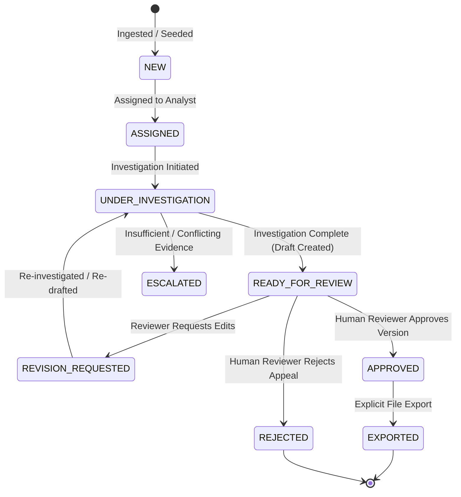
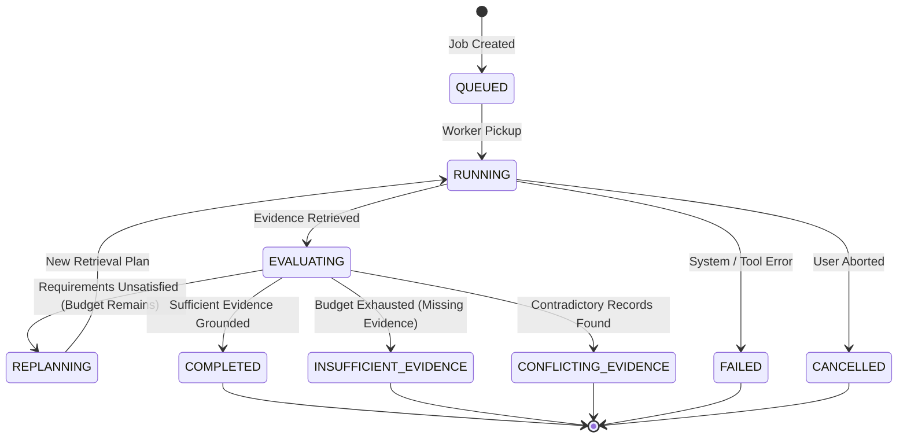

# Product Contract & System Principles

**Project Title:** Agentic Evidence-Retrieval & Appeal Generation for Insurance Claim Denial Management: A Human-in-the-Loop Approach  
**Product Principle:** AI investigates. Evidence supports. A human decides.  
**Specification Status:** Phase 1 Design & Specification Contract (Authoritative)  
**Target Repository:** `C:\dev\Agentic_Denial_Management`

---

## 1. System Vision & Product Statement

Healthcare revenue cycle management (RCM) teams face massive administrative overhead when investigating payer claim denials. Denial specialists must gather patient clinical records, diagnostic reports, physician orders, and operative notes across Electronic Health Record (EHR) systems, compare them against complex payer clinical coverage policies, evaluate whether prior authorizations or coding rules were satisfied, and draft formal appeal packages.

This platform provides an **agentic, source-grounded evidence retrieval and appeal generation system** that accelerates investigation while strictly enforcing human decision authority. The system operates under the foundational mandate:

> **"AI investigates. Evidence supports. A human decides."**

### Core Invariants & Boundaries
1. **Zero Autonomous Submission:** The platform shall never automatically transmit, file, or submit an appeal to an insurance payer or clearinghouse. Export is permitted only after explicit human authorization.
2. **Deterministic Provenance:** Every factual statement in an appeal draft must cite an active `EvidenceChunk` tied to a canonical clinical or financial source record for the specific patient.
3. **Mandatory Multi-Tenant & Patient Isolation:** Patient scope and organization tenant boundaries are enforced server-side before any query reaches retrieval engines or LLM contexts.
4. **Synthetic Data Realism:** All clinical and financial entities are synthetic, generated deterministically from seedable profiles, visibly labelled as synthetic, and contain zero protected health information (PHI).
5. **Separation of Concerns:** Python business logic owns permissions, state transitions, validation, and exports. The LLM is restricted to proposing search queries, interpreting denial text, evaluating evidence against policy criteria, and synthesizing draft prose within strict citation rules.

---

## 2. Primary Users & Role-Based Access Control (RBAC)

The application defines five operational roles with strictly segregated privileges:

| Role | Scope & Permissions | Key User Journeys & Actions |
|---|---|---|
| **Denial Analyst** | Operational claim-level access within assigned tenant | View assigned claims in the queue; initiate investigation runs; inspect clinical evidence and provenance; edit appeal drafts; flag claims for supervisor review. |
| **Reviewer / Senior Specialist** | Supervisory & review authority within assigned tenant | Review complete investigation traces; inspect cited evidence; compare draft versions; explicitly approve, reject, or request revision on appeal drafts; trigger authorized exports. |
| **RCM Manager** | Queue & departmental operational oversight | View aggregate operational queues; assign and reassign claims; monitor turnaround times, denial categories, stuck cases, and analyst workloads. |
| **Auditor / Compliance Officer** | Read-only compliance & forensic audit access | View immutable audit logs, model traces, grounding reports, export history, and actor timelines across all tenant records. Cannot modify claims or drafts. |
| **Data Administrator** | Environment & dataset management (Non-production only) | Generate synthetic datasets from seeds/profiles; run dataset validation suites; rebuild full-text and FAISS retrieval indexes; run benchmark suites. (Disabled in production). |

---

## 3. Workflow Lifecycles & State Transitions

### 3.1 Claim Lifecycle

- **`NEW`**: Claim ingested with an active denial event from remittance advice. Unassigned.
- **`ASSIGNED`**: Claim allocated to a denial analyst for handling.
- **`UNDER_INVESTIGATION`**: Active LangGraph agent run executing evidence retrieval and requirement evaluation.
- **`READY_FOR_REVIEW`**: Investigation complete; evidence requirements evaluated; grounded appeal draft ready for human inspection.
- **`ESCALATED`**: Investigation determined that evidence is missing or conflicting; flagged for manual intervention.
- **`REVISION_REQUESTED`**: Senior reviewer inspected draft and requested modifications or additional evidence.
- **`APPROVED`**: Reviewer explicitly verified citations and authorized a specific appeal draft version.
- **`REJECTED`**: Reviewer determined the denial is valid or non-appealable; claim closed without appeal.
- **`EXPORTED`**: Authorized appeal package exported to a local file artifact.

### 3.2 Investigation Run Lifecycle

- **`QUEUED`**: Investigation request accepted by API; assigned public `run_id`.
- **`RUNNING`**: Active LangGraph orchestration executing interpretation and retrieval tool calls.
- **`EVALUATING`**: Evaluating retrieved clinical evidence against payer policy criteria.
- **`REPLANNING`**: Evidence partially missing; refining search terms and targets within bounded retry budget.
- **`COMPLETED`**: Evidence sufficiency verified; appeal draft synthesized and citations validated.
- **`INSUFFICIENT_EVIDENCE`**: Search budget exhausted without satisfying mandatory criteria.
- **`CONFLICTING_EVIDENCE`**: Clinical records contain irreconcilable contradictions (e.g., negative pathology vs positive progress note).
- **`FAILED`**: Unrecoverable runtime or service failure (Ollama timeout, DB disconnect).
- **`CANCELLED`**: User manually cancelled the run.

### 3.3 Appeal Draft Version Lifecycle
- **`DRAFT`**: Candidate draft generated by agent or created via analyst manual edit.
- **`VALIDATED`**: Passed deterministic grounding validation (all citations resolve to active run evidence chunks).
- **`INVALID_GROUNDING`**: Failed citation validation (contains ungrounded, hallucinated, or cross-patient citations).
- **`SUPERSEDED`**: Replaced by a newer version following edits or re-investigation.
- **`APPROVED`**: Locked, immutable version signed off by an authorized reviewer.
- **`REJECTED`**: Locked version rejected by reviewer.

---

## 4. Denial Categories & Scenario Taxonomy

The system defines 12 standard denial categories with concrete operational definitions:

| Code | Denial Category | Clinical / Operational Definition | Key Required Evidence Types |
|---|---|---|---|
| `MED_NEC_01` | Medical Necessity | Payer claims service was not clinically indicated under clinical coverage guidelines. | Diagnostic reports, progress notes, failed conservative therapies, severity scores. |
| `PA_MISS_02` | Prior Authorization Missing / Invalid | Required pre-service authorization was not obtained, expired, or had mismatched codes. | Prior auth approval letter, reference numbers, date ranges, authorized CPT codes. |
| `DOC_INCOMP_03` | Missing or Incomplete Documentation | Payer claims submission lacked required operative reports, clinical notes, or pathology. | Operative reports, discharge summaries, nursing flowsheets, pathology reports. |
| `CODE_MISMATCH_04` | Coding / Documentation Mismatch | Procedure code (CPT) does not correlate with primary diagnosis (ICD-10) or modifiers. | Physician notes confirming diagnosis severity, operative technique, anatomically specific modifiers. |
| `DUP_BUNDLE_05` | Duplicate or Bundled Service | Line denied as duplicate or bundled into primary surgical/medical procedure (NCCI edits). | Timestamps, distinct operative sites, modifier 59/XS/XU justification, distinct encounters. |
| `ELIG_TIMING_06` | Eligibility / Coverage Timing | Payer claims member was ineligible on date of service or policy was terminated. | Eligibility verification logs, active enrollment documentation, effective date history. |
| `UNTIMELY_07` | Untimely Filing | Claim submitted after payer contractual filing window (e.g., 90/180 days). | Clearinghouse transmission acknowledgments, initial 837 acceptance logs, payer delay proof. |
| `NON_COV_08` | Non-Covered Service / Exclusion | Service deemed an excluded benefit under the member benefit plan document. | Plan benefit booklet, medical exception criteria, off-label clinical indications. |
| `UNITS_MOD_09` | Units / Modifier Inconsistency | Billed units exceed Medically Unlikely Edits (MUE) or incompatible modifier used. | Dosage calculations, medication administration records (MAR), time-based service logs. |
| `COB_OTHER_10` | Coordination of Benefits (COB) | Payer asserts secondary status and demands Primary Explanation of Benefits (EOB). | Primary payer EOB/remittance, coordination of benefits questionnaire, member attestations. |
| `INSUF_INFO_11` | Insufficient Information / ADR | Payer issued an Additional Documentation Request prior to final adjudication. | Full encounter documentation package, diagnostic imaging, physician consultation notes. |
| `CLIN_CONFLICT_12` | Conflicting Clinical Evidence | Records contain contradictory clinical evidence requiring clinical escalation. | Comparative analysis of conflicting physician notes, lab discrepancies, pathology reports. |

---

## 5. Evidence Sufficiency Taxonomy

Every requirement generated by the investigation agent is evaluated against retrieved patient evidence and assigned one of four definitive labels:

| Label | Definition | Drafting Action |
|---|---|---|
| **`SUPPORTED`** | Direct, unambiguous clinical documentation satisfies all criteria of the policy requirement with valid dates and provider attribution. | Drafting proceeds; evidence cited in appeal. |
| **`PARTIALLY_SUPPORTED`** | Evidence satisfies core clinical criteria but lacks secondary metadata (e.g., missing specific duration of conservative therapy). | Drafting proceeds with explicit disclosure of limitation. |
| **`MISSING`** | Comprehensive search across encounters, notes, and diagnostics yielded zero supporting evidence. | Triggers bounded replanning; if budget exhausted, terminates as `INSUFFICIENT_EVIDENCE`. |
| **`CONFLICTING`** | Retrieved records contain mutually exclusive clinical assertions (e.g., negative finding in report vs positive assertion in physician progress note). | Appeal drafting blocked; terminates as `CONFLICTING_EVIDENCE` for human review. |

---

## 6. Safety, Scoping & Privacy Boundaries

1. **Patient Scoping Invariant:** Under no circumstance shall an evidence chunk, FHIR resource, or clinical note belonging to Patient A be accessible or returned in a query scoped to Patient B.
2. **Deterministic Grounding Invariant:** Every citation in an appeal draft must resolve to an active `EvidenceChunk` ID in the current investigation run. Unresolvable citations cause draft validation failure.
3. **No Phantom Approvals:** An appeal cannot be exported unless an authorized human user has submitted an approval event on that exact draft version ID.
4. **Local Model Isolation:** All clinical texts and synthetic records remain on the local host. No PHI or synthetic notes are transmitted to unverified external cloud endpoints.
5. **Visible Synthetic Notice:** All UI screens, exports, and generated datasets must display the notice: *"SYNTHETIC DATA — FOR DEMONSTRATION & RESEARCH PURPOSES ONLY"*.
